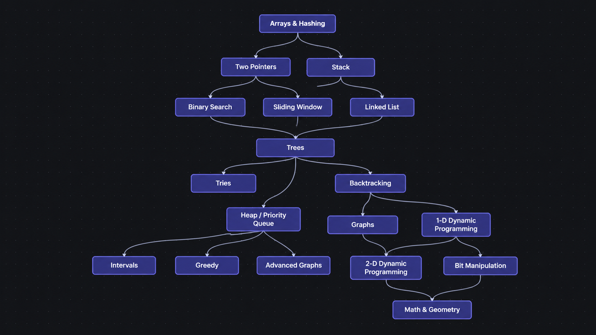

# NeetCode Solutions 🚀

My C++ solutions to coding interview problems from [NeetCode](https://neetcode.io).

This repository documents my journey of learning Data Structures and Algorithms, improving problem-solving skills, and preparing for software engineering interviews.

## 🗺️ NeetCode Roadmap

The roadmap below represents the topics I am working through to strengthen my DSA fundamentals.

## 💻 Language

- C++

## 🎯 Goals

- Strengthen Data Structures and Algorithms fundamentals.
- Write clean and efficient C++ solutions.
- Understand time and space complexity.
- Practice consistently and improve problem-solving skills.
- Prepare for software engineering placements in 2027.

## 🔄 Automatic Sync

Solutions are synced from NeetCode using its GitHub integration.

- **Platform:** [NeetCode](https://neetcode.io)
- **Language:** C++
- **Sync settings:** [GitHub Integration](https://neetcode.io/profile/github)

---

*One problem at a time. One step closer to the goal.*
